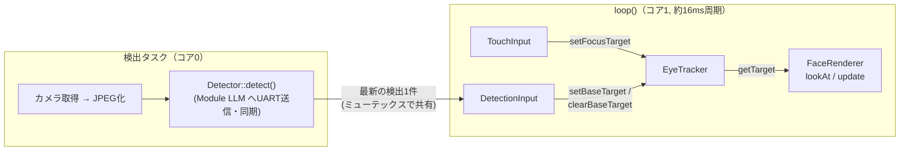

# CoreS3 + YOLO プロジェクトへの移植計画

Avator の顔アバター（視線制御つき）を、M5Stack CoreS3 + Module LLM で YOLO 物体検知を行う
プロジェクト [furuTra/m5stack-vlm](https://github.com/furuTra/m5stack-vlm)（ブランチ
`reduce-jpeg-quality-for-uart`）へ移植し、**検知した物体の位置へ視線を向ける**ための計画。

参照用 clone: `reference/m5stack-vlm/`（`.gitignore` 対象。サブモジュール `lib/yolo_object_detector` 初期化済み）

## 移植先の構成（調査結果）

- フレームワークは **PlatformIO + Arduino + M5Unified**（Avator と同じ）。`board = m5stack-cores3`、
  `board_build.psram = enable`。
- YOLO は **CoreS3 ではなく Module LLM（AX630C）上で推論**する。CoreS3 はカメラ(GC0308, QVGA)の
  フレームを JPEG 化して UART(1.5Mbps)で送り、検出結果を受け取るだけ（`lib/yolo_object_detector`）。
  → ESP-DL 等のオンデバイス推論ライブラリは不要。
- 検出結果 `DetectedObject` の bbox は **入力JPEG(=カメラフレーム 320x240)のピクセル空間**の
  `[x1,y1,x2,y2]`。LCD(320x240)と 1:1。
- `detect()` は JPEG 送信〜推論結果の受信まで**同期でブロック**する。
- カメラ映像は**鏡像**（ユーザーが右手を上げると画面右側が動く）。現在は LCD に何も表示せず、
  検出座標をシリアルへ出力するだけ。

## 決定事項

| 項目 | 決定 |
| --- | --- |
| コードの持ち込み方 | まず**コピー**で動作確認し、その後 `yolo_object_detector` と同様に独立リポジトリ化してサブモジュールで共有する |
| 画面 | **アバターのみ**表示する（カメラプレビュー・検出枠は出さない） |
| 追従対象の選び方 | 当面は現在の YOLO 検知処理のまま（`kMinConfidence` 以上の全クラス）。選択ルールは未確定課題 |
| 入力 | **検出 + タッチ**。IMU(傾き)入力は持ち込まない |
| 左右反転 | カメラフレームが鏡像のため、bbox の x は**反転せずに**画面座標として扱う（下記） |

### 左右反転を不要と判断した理由

鏡像フレームでは、ユーザーから見て右にいる物体はフレームの右側に写る。Avator の視線は
「画面上の点を見る」（タッチした位置を見るのと同じ）ので、フレーム右側の点を渡すと瞳は画面右へ動き、
ユーザーから見て物体のいる側を向く。したがって x はそのまま使う。実機確認で逆だった場合に備え、
`DetectionInput` に反転の定数を用意しておく。

## ライブラリ構成

新規の外部ライブラリは不要。

| 用途 | ライブラリ | 備考 |
| --- | --- | --- |
| 画面・タッチ | `m5stack/M5Unified` | 移植先で使用中 |
| カメラ | `m5stack/M5CoreS3`（esp32-camera 同梱） | 移植先で使用中 |
| YOLO | `lib/yolo_object_detector`（M5Module-LLM, ArduinoJson） | 移植先で使用中 |
| 視線計算 | `GazeController`, `EyeTracker` | Avator からコピー（デバイス非依存） |
| 顔描画 | `FaceRenderer`, `AssetLoader` | Avator からコピー（M5Unified + LittleFS） |
| タッチ入力 | `TouchInput` | Avator からコピー |
| アセット | LittleFS | ボード既定の `default_16MB.csv` の spiffs 領域を LittleFS として使う（パーティション変更不要の見込み） |

## 統合後の構成

- 周辺機器の担当を分ける: 検出タスクはカメラ・`Serial2`・`Detector` だけ、`loop()` は `M5.update()`
  と描画(`M5.Display`)だけを使う。
- 優先度: **タッチ = 注目点（優先、離した後も `FOCUS_HOLD_MS` 保持）**、**検出 = 既定の追従先**。
- 検出が一定時間（`DETECTION_HOLD_MS`）途切れたら既定の追従先を解除し、正面（中立点）へ戻す。

### DetectionInput（新規、移植先 `lib/` か `src/` に置く）

入力モジュールの約束どおり `getPoint(x, y)` で「いまの点」を返すだけにする。

- 検出タスクから `setDetection(bbox)` で最新結果を受け取る（ミューテックス保護、時刻を記録）。
- `getPoint(x, y)`: 保持期限内なら bbox 中心を画面上の点へ変換して `true`。
  変換はフレーム中心を視線の中立点（目の中心）へ合わせる:
  `x = 中立点X + (cx - 160) * GAIN_X`、`y = 中立点Y + (cy - 120) * GAIN_Y`
  （目の中心は約(161,160)でフレーム中心(160,120)とずれるため、座標をそのまま渡すと常にやや上を向く）。
- 左右反転の定数（既定は反転しない）、複数検出からの選択（当面は下記の暫定ルール）もここへ閉じ込める。

### EyeTracker の小変更

現状は既定の追従先が一度設定されると保持され続ける（IMU は常に値を出していたため問題にならなかった）。
検出は途切れるので `clearBaseTarget()` を追加し、`main` は入力が無いときも中立点へ `lookAt` する
（正面へ戻す）ように変える。Avator 側にも同じ変更を入れて、両者のコードを揃える。

## 移植手順

1. **アセット**: Avator の `data/assets/avatar/` を移植先の `data/` へコピーし、`platformio.ini` に
   `board_build.filesystem = littlefs` を追加して `pio run -t uploadfs`。`tools/` とマスター素材
   `assets/avatar/` も持ち込む。
2. **ライブラリ**: `GazeController` / `EyeTracker` / `FaceRenderer` / `AssetLoader` / `TouchInput` を
   移植先 `lib/` へコピーする。
3. **顔だけで起動確認**: 検出を止めた状態で、静止顔・まばたき・タッチ追従を確認する。`M5.begin()` は
   `cores3_hal::begin()` の1回だけにし、起動ログ表示（ModuleLLM 接続待ち等）の後に顔を描く。
4. **DetectionInput** を作成する（上記）。
5. **検出タスク**: 現在の `loop()` の「撮影 → JPEG化 → detect → 解放」を `xTaskCreatePinnedToCore` で
   コア0のタスクへ移し、結果を `DetectionInput` へ渡す。シリアルログ出力は残す。
6. **main の接続**: `touchInput` → `setFocusTarget`、`detectionInput` → `setBaseTarget` / `clearBaseTarget`、
   `getTarget` → `faceRenderer.lookAt` → `update`。
7. **実機調整**: 左右の向き、`GAIN_X/Y`、`DETECTION_HOLD_MS`、`FOCUS_HOLD_MS`、検出と並行したときの描画時間。
8. **パッケージ化**: 動作確認後、顔アバター一式を独立リポジトリへ切り出してサブモジュール化する。
9. **ドキュメント**: 両リポジトリの `docs/` を更新する。

移植先の `CLAUDE.md` は、`src/main.cpp`・`src/hal/` の変更を担当エージェントへ委譲し、完了後に
`pio-build-check` と `cpp-code-review` を呼ぶことを求めている。移植先で実装する際はそれに従う。

## 未確定課題

- **追従対象の選択ルール**: 対象クラス（`person` のみ / 全クラス）と、複数検出時にどれを見るか
  （面積最大 / 信頼度最大 / 前回位置に最も近いもの）。暫定は「`kMinConfidence` 以上のうち信頼度最大」。
- 左右の向きが実機で正しいか（上記の判断は鏡像プレビューの観察に基づく）。
- `GAIN_X/Y`（カメラの画角と視線の振れ幅の対応）、`DETECTION_HOLD_MS` の値。
- 検出タスクの JPEG 化・UART 転送と並行したときの描画時間（Core2 実測の約11ms/回が維持できるか）。
- 独立リポジトリ化するときの構成（アセット生成物 `data/` の扱い。生成ヘッダは定義ファイル方式への移行で
  廃止済みで、アバター固有の情報は `avatar.json` にまとまっている → [avatar-definition.md](avatar-definition.md)）。

関連ドキュメント: [アーキテクチャ](architecture.md) / [描画方針](rendering.md) / [アセット管理](assets.md)
