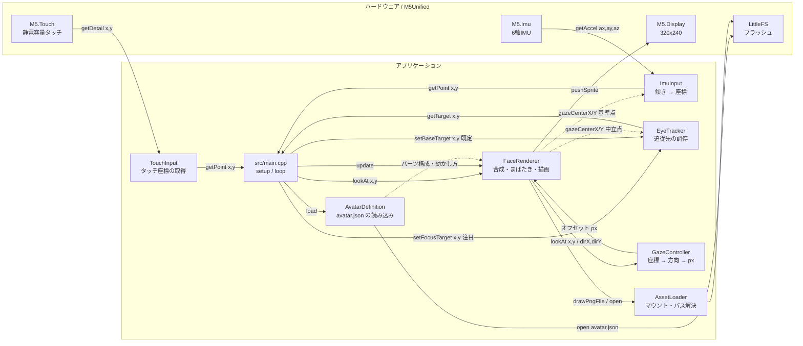
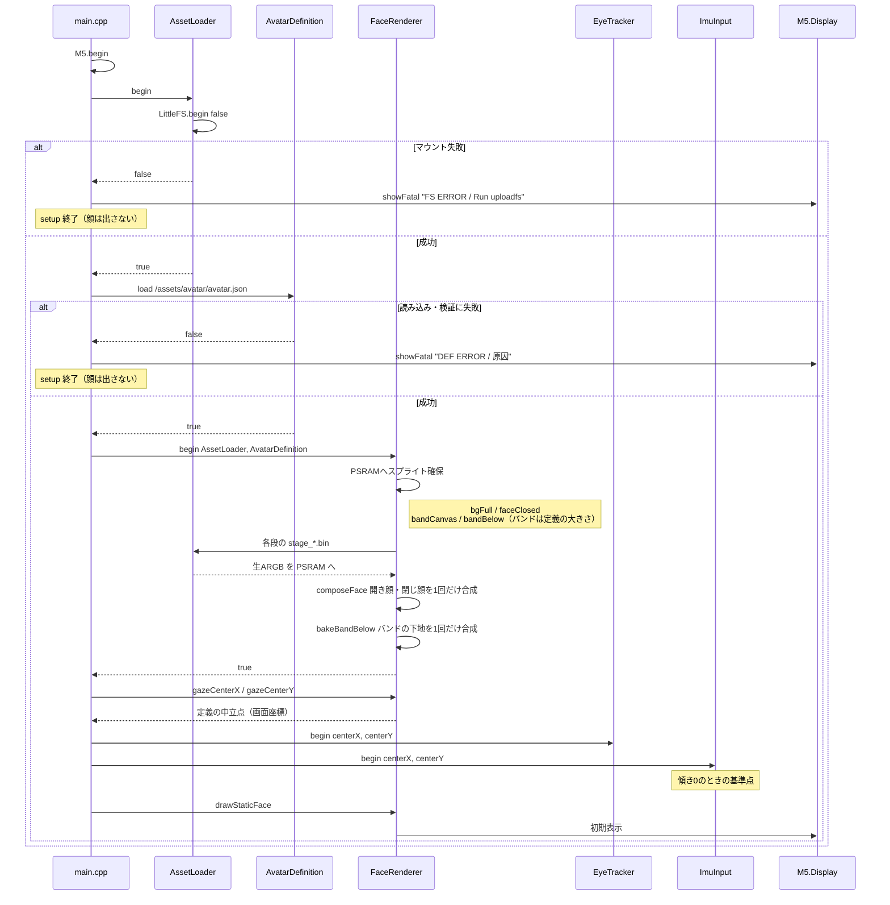
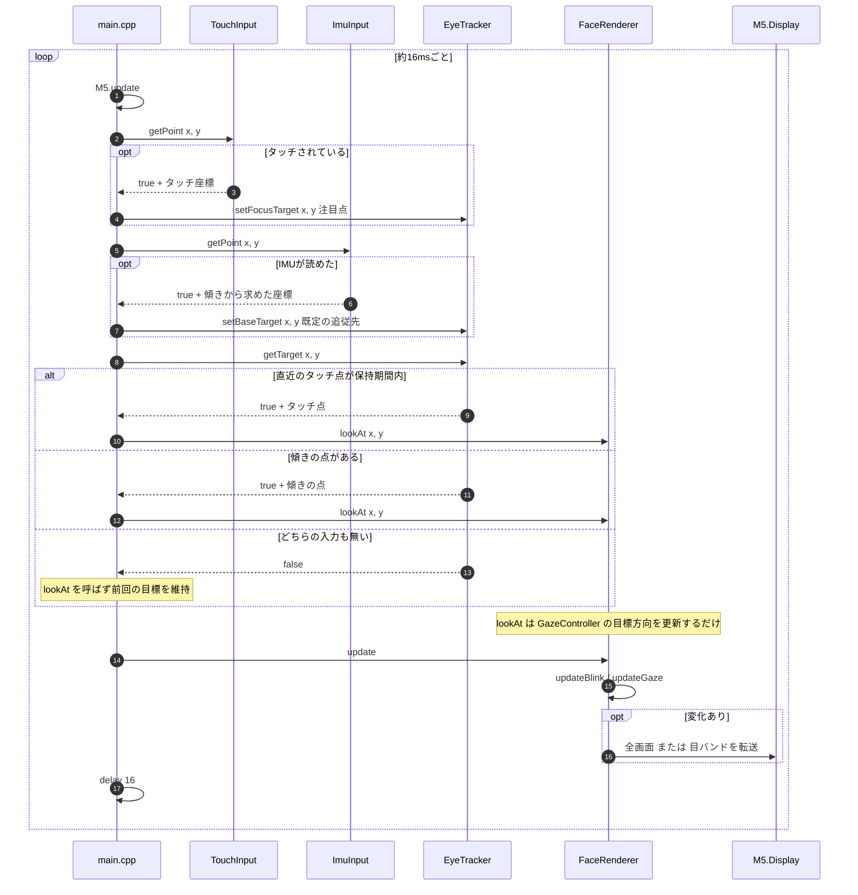
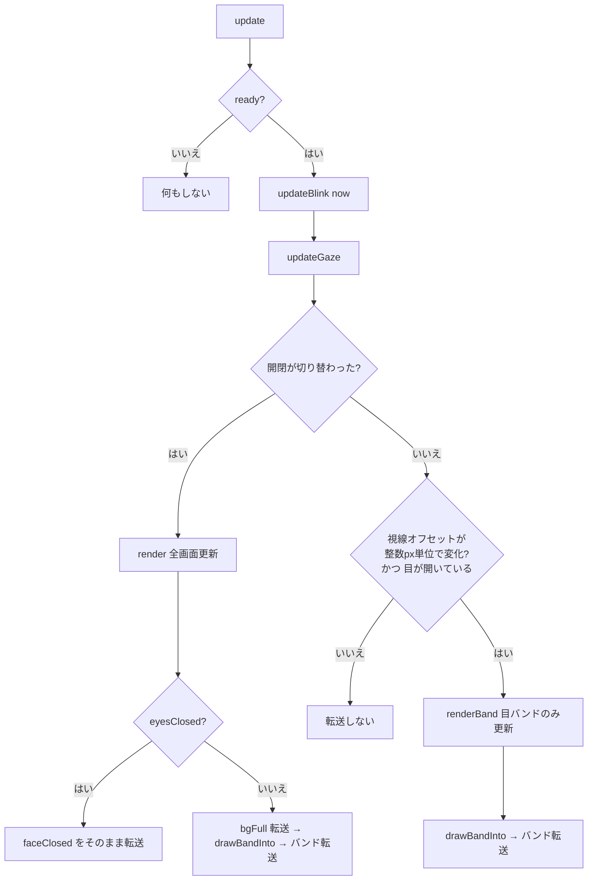
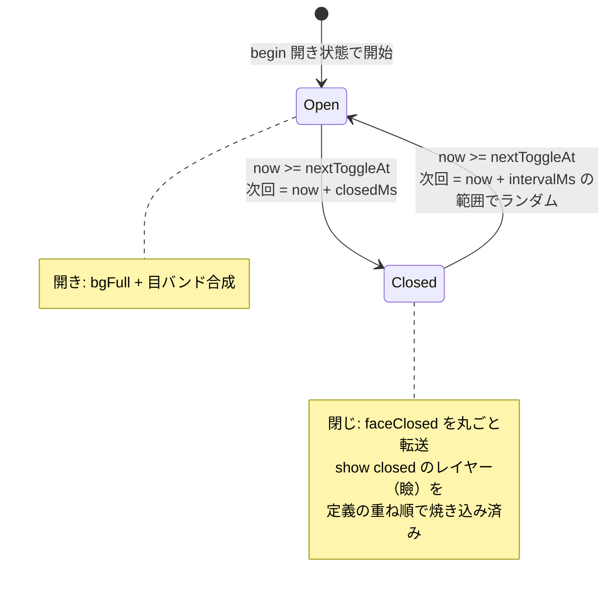
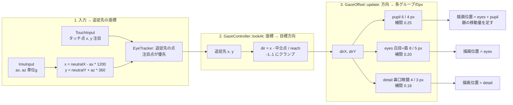
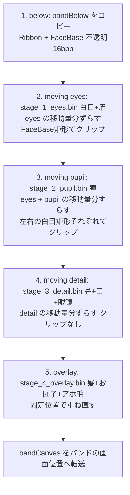
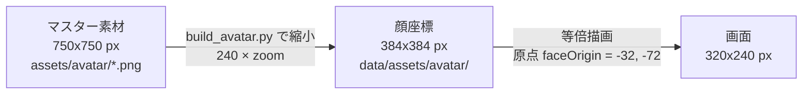
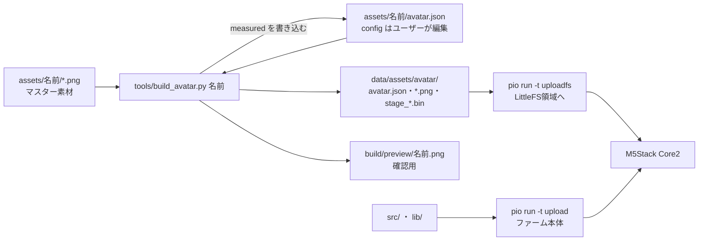

# 処理フロー（現行実装の解説）

`src/main.cpp` + `lib/` の現行実装が、起動から毎フレームの描画まで何をしているかを図で示す。
方針の「なぜ」は [architecture.md](architecture.md) / [rendering.md](rendering.md)、
チューニング定数の意味は [spec/face-avatar/eye-tracking.md](../spec/face-avatar/eye-tracking.md) を参照。

---

## 1. モジュール構成と依存の向き

`main.cpp` は「入力(TouchInput / ImuInput) → 調停(EyeTracker) → 視線(FaceRenderer)」の橋渡しに徹する。
`FaceRenderer` はタッチもIMUも知らず、追従先の**座標**だけを受け取る（入力源を差し替えられる境界）。
さらに視線の計算そのものは `GazeController` が持ち、`FaceRenderer` は求まったオフセットで描くだけ。

- `TouchInput` / `ImuInput` はどちらも「いまの点(x,y)」を返すだけの入力モジュール。デバイス固有の事情
  （押下判定、加速度の軸・符号・感度）はそれぞれの中に閉じている。
- `EyeTracker` は点がどこから来たかを知らず、受け取った点の**優先度と保持**だけを決める。どの入力を
  注目(優先)／既定に割り当てるかを決めるのは `main` の役目（現在はタッチ＝注目、傾き＝既定）。
- `FaceRenderer` の入口は `lookAt(x, y)` と `update()` の 2 つだけ。受け取った点はそのまま
  `GazeController` へ渡し、返ってきたオフセット(px)で描く。
- `GazeController`（+ `GazeOffset`）は**標準ライブラリだけに依存する純粋な計算**で、他プロジェクトへ
  そのまま流用できる（[lib/GazeController/README.md](../lib/GazeController/README.md)）。
- アバター固有の情報（パーツ構成・重ね順・動かし方・計測値）は `AvatarDefinition` が起動時に
  `avatar.json` から読む。`FaceRenderer` は特定のパーツ名や座標を持たず、その内容に従って描く
  （[avatar-definition.md](avatar-definition.md)）。
- ファイルパスは `AssetLoader` に集約し、他モジュールは持たない。

---

## 2. 起動処理 `setup()`

重い処理（PNGデコード・生ARGBの読み込み）は**すべて起動時に済ませる**。実行時は合成済みの
ビットマップを動かすだけにするのが基本設計。

定義ファイルの読み込みに失敗した場合（ファイルが無い・`schemaVersion` が対応外・必要なキーの欠落）は
`DEF ERROR` と原因を表示する。確保に失敗した場合（PSRAM不足・binの欠損）は `MEM ERROR` を表示して `ready` を false のままにし、
以後 `update()` は何もしない。

---

## 3. 毎フレーム `loop()`

`delay(16)` でおおよそ 60fps のペースで回すが、**描画は状態が変化したフレームだけ**行う。

---

## 4. `FaceRenderer::update()` の分岐

まばたきの開閉が切り替わったときだけ全画面を転送し、視線の動きだけなら目バンド（大きさは
定義ファイルの `band`。現在のアバターで 178x102）の小領域で済ませる。全画面転送 約55ms に対しバンド転送は約11ms（[rendering.md](rendering.md) の実測）。

- 動くグループが無いアバター（`band` が無い）では視線による再描画はせず、まばたきだけを行う。
- 目を閉じている間は瞳も白目も見えないため、`updateGaze()` の計算だけ進めて再描画はしない
  （`gazeChanged = updateGaze() && !eyesClosed`）。
- 変化の判定は **float の現在値ではなく `lroundf` した整数px**で行う。1px 未満の揺れでは転送しない。

---

## 5. まばたきの状態遷移

閉じ顔を事前合成してあるので、まばたきは「別スプライトへの差し替え」だけで済む。
時間は定義ファイルの `config.blink`（現在のアバターは closedMs 180ms / intervalMs 2500〜6000ms）。

---

## 6. 視線の値の流れ（タッチ・IMU → 画面上のpx）

入力から描画オフセットまでの変換は 3 段階。段ごとに責務が分かれている。

- 段 2・3 は `lib/GazeController/` に閉じており、段 1（点の作り方）と描画のどちらも知らない。
  中立点・`reach`・グループごとの可動量と追従係数はアバター固有の値で、定義ファイルから
  `FaceRenderer::begin()` が渡す。図中の値は現在のアバター（`assets/avatar/avatar.json`）のもの。

- **タッチが最優先**。`TouchInput` が取り出した画面座標は、変換せずそのまま追従先の点になる
  （可動域を超える分は `lookAt` がクランプする）。指を離した後も `FOCUS_HOLD_MS`（1500ms）はその点を
  見続け、その後 `ImuInput` の点へ戻る。
- `ImuInput` は左右が `ax`（IMU軸と画面軸が90°ずれるため符号反転）、上下が `az`（画面法線方向の重力成分）。
  縦に立てる＝正面 / 横に寝かせる＝下 / 逆さ＝上。
- 全グループが同じ向きへ寄るが、可動量（横 6 / 8 / 4 px）と補間係数（0.25 / 0.20 / 0.18）を変えてある。
  瞳がいちばん速く追従し、顔まわりのパーツはより緩やかに遅れて寄るため、顔全体が傾きへ引っぱられて
  見える。
- 瞳（`pupil`）は `parent: eyes` のため、描画位置は **白目グループの移動 + 瞳自身の移動** の合成
  （白目ごと動いた上で、その中を瞳が動く）。

---

## 7. 目バンドの合成（`drawBandInto`）

バンドは「動く段をすべて、可動量分の余白込みで内包する矩形」（`tools/build_avatar.py` が決定し、
定義ファイルの `band` に書く）。毎回バンド全面を下地から作り直すため、移動元に前フレームの残像は残らない。
`drawBandInto` は定義ファイルの `stages` を順に重ねるだけのループで、下図は現在のアバターの段構成。

- 段の位置 = 段の `rect` の位置 + グループの移動量（親の分を含む）。段の画像は `rect` 原寸なので、
  ずらして描けばそのまま平行移動になる。
- クリップの目的: 白目・眉は `FaceBase` からはみ出さないように、瞳は**左右それぞれの白目矩形**へ。
  左右は鼻筋で分かれているため単一矩形だと隙間へはみ出す（`clip.mode: components`）。
  クリップ矩形は親グループの移動量分ずらすため、白目が寄れば瞳のクリップ範囲も追従する。
- 最上位レイヤーをバンド内で重ね直すのは、`Hair → Glasses → Eye → FaceBase` のZ順を保つため
  （眉の大半・眼鏡の一部は前髪の裏に隠れる）。
- 半透明を含むレイヤーを**生ARGB**で持つ理由: M5GFX の `drawPng` はスプライト宛だと半透明画素の
  アルファを保持しない（読み戻して不透明色で書き戻す）。`pushAlphaImage` なら破綻しない。

---

## 8. 座標系の対応

`zoom`（現在のアバターは 1.6）はアセット側へ焼き込み済みなので実行時の倍率は 1.0。拡大デコード（低速）を
避けるための設計。計測も縮小後の画像で行うため、定義ファイルの座標（`band`・`rect`・`clipRects`・
`gazeCenter`）はすべて顔座標で、画面座標 = 顔座標 + `faceOrigin`。

---

## 9. アセット生成からデバイスまで

ファーム本体はアバターに依存しない（生成ヘッダは無い）。素材・定義ファイルの変更やアバターの差し替えは
`build_avatar.py` → `uploadfs` だけで反映でき、ファームの書き込みはコードを変えたときだけ要る。

---

関連ドキュメント: [アーキテクチャ](architecture.md) / [描画方針](rendering.md) /
[アセット管理](assets.md) / [ビルド・実行](build.md) / [顔アバター実装仕様](../spec/face-avatar/README.md)
